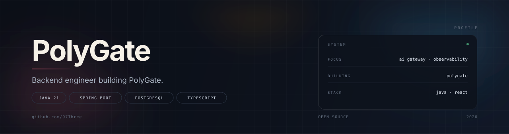



  

  后端工程师 · AI 网关 · 可观测性

---

### 关于

我关注模型流量"后半段"的事情：请求怎么进来、怎么路由、怎么限额、怎么结算，以及出问题时怎么查。

- 🔭 目前在写 [**PolyGate**](https://github.com/97Three/polygate) —— 自托管的多模型 API 网关，原生兼容 Anthropic Messages 与 OpenAI Chat Completions，内置 Provider 路由、配额预算与运维控制台
- 🧱 常用技术：**Java 21 / Spring Boot 3.5 / PostgreSQL / React 19 / TypeScript**
- 🧩 偏好"一个进程交付"：可执行 JAR 内嵌管理台，不额外依赖 Node 或独立前端容器
- 🧪 重视测试与可观测性：后端 51 项、前端 130 项测试，Prometheus 抓取与 Grafana 面板随仓库交付

### 技术栈

  
  
  
  
  
  

### 精选项目

**PolyGate** —— 自托管的多模型 API 网关

> Anthropic ↔ OpenAI 双协议接入、Provider 凭证池与故障切换、配额/预算/只追加账本、11 个页面的管理控制台。
> 一个 `polygate-1.0.0.jar` 起服务，PostgreSQL 存配置与流水。

`Java 21` · `Spring Boot` · `PostgreSQL` · `Flyway` · `React` · `Prometheus`

[查看仓库 →](https://github.com/97Three/polygate)

### GitHub

  
  

---

  Java & TypeScript · Self-hosted · MIT

